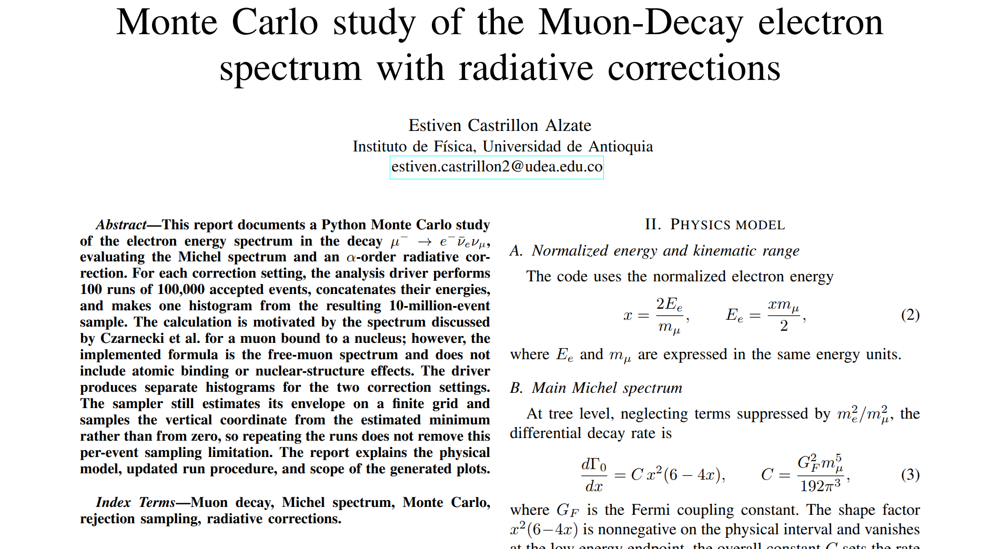

# Monte Carlo Simulation of Muon Decay (Michel Spectrum)

This project simulates the electron-energy spectrum for free negative-muon decay,
$$
\mu^- \to e^- + \bar{\nu}_e + \nu_\mu,
$$
with an optional order-$\alpha$ radiative correction. It is a learning and analysis
project exploring the Michel spectrum and the Monte Carlo acceptance--rejection
method. The implementation is inspired by Czarnecki et al. (2014), whose paper
studies a muon bound to a nucleus.

**Scope note:** the current code evaluates the free-muon spectrum. It does not
include atomic binding, a nuclear Coulomb field, nuclear recoil, or nuclear-structure
effects, so it is not a simulation of the complete bound-muon calculation in the
reference paper. See the [full report](docs/main.pdf) for the model, derivation,
analysis, and limitations.

[](docs/main.pdf)

---

## Physics background
See the full report above.

### Reference

> A. Czarnecki, M. Dowling, X. Garcia i Tormo, W. J. Marciano, and R. Szafron,
> “Michel decay spectrum for a muon bound to a nucleus,” *Physical Review D*,
> vol. 90, no. 9, 093002 (2014). DOI:
> [10.1103/PhysRevD.90.093002](https://doi.org/10.1103/PhysRevD.90.093002).

---

## Repository structure

```text
monte-carlo-particle-decay/
├── README.md
├── LICENCE
├── environment.yml
├── pyproject.toml
├── requirements.txt
├── docs/
│   ├── figures/                        # Report preview and university logo
│   ├── main.tex                         # LaTeX report source
│   ├── main.pdf                         # Compiled report
│   └── references.bib
├── notebooks/
│   └── 01_analysis_of_results/
│       └── muon_decay_rate_analysis.ipynb
├── results/
│   ├── data/                           # Generated NumPy samples
│   └── plots/                          # Generated spectrum plots
├── scripts/
│   ├── run_analysis.py                  # 100 runs per correction setting
│   └── run_analysis.sh                  # Shell wrapper
├── src/python/
│   └── muonMonteCarlo.py                 # Spectrum, sampler, and plotting class
└── tests/
   ├── test.py                          # Basic class and output tests
   └── testing_pdf_function.py          # Exploratory rate/boundary analysis
```

Generated samples and plots may be ignored by Git, they can be regenerated by
running the analysis. The current driver runs 100 simulations of 100,000 accepted
events for each correction setting, then concatenates the energies and plots one
10-million-event histogram per setting. Each simulation saves to the same
per-setting, per-run filename, so the `.npy` files contain only the final
100,000-event run, not the concatenated data used in the plots. The notebook's
embedded comparison and its 100-million-event inputs are from an earlier analysis.

---

## Installation

Use a virtual environment with a Python version supported by the installed
dependencies (the notebook metadata records Python 3.12.3). The repository's
`requirements.txt` is currently empty and `environment.yml` specifies Python 3.9
with additional packages not required by this simulation. For a minimal pip setup:

```bash
python3 -m venv .venv
source .venv/bin/activate       # Windows: .venv\Scripts\activate
python -m pip install --upgrade pip
python -m pip install numpy scipy matplotlib scienceplots tqdm particle pytest jupyter
```

LaTeX is required only to rebuild the report. Install a TeX distribution that
includes `latexmk`, `pdflatex`, and BibTeX. From the `docs/` directory, build with:

```bash
latexmk -pdf -interaction=nonstopmode -halt-on-error main.tex
```

---

## Usage

### Run both simulation cases

From the repository root:

```bash
python scripts/run_analysis.py
```

The script performs 100 runs of 100,000 accepted events for each correction
setting, for $10^7$ accepted events per setting. The final histogram is made from
the concatenated energies. This can take considerable time and memory because
all runs' energies are held in memory before plotting. To adjust the workload,
change `n_runs` and `n_events` in [`scripts/run_analysis.py`](scripts/run_analysis.py).
The supplied run reported an observed energy range of about $0.3075$--$52.8287$
MeV, the observed minimum varies with the random sample and is not a physical
kinematic threshold.

The script saves paired arrays of normalized energy $x$ and electron energy
$E_e$ (in MeV) under `results/data/`, and writes individual histograms under
`results/plots/`. Output filenames include whether radiative corrections were
enabled and the per-run event count. Since each run reuses the same output filename,
the final `.npy` files hold one run each, the combined samples used for the plots
are not saved. Current plots are [with radiative corrections](results/plots/muon_decay_spectrum_with_radiative_corrections.png)
and [without radiative corrections](results/plots/muon_decay_spectrum_without_radiative_corrections.png).
The shell wrapper currently invokes the script relative to its working directory,
so run it from `scripts/`:

```bash
cd scripts
bash run_analysis.sh
```

### Basic API example

```python
from src.python.muonMonteCarlo import muonMonteCarlo

mc = muonMonteCarlo(n_events=1_000, include_radiative=True)
mc.simulation(x_min=4.770585e-03, x_max=0.99999)
mc.graphical_analysis(
  title="Muon decay electron energy spectrum",
  xtitle="Electron energy $E_e$ [MeV]",
  ytitle="Number of events",
)
```

### Explore the analysis notebook

Open [`notebooks/01_analysis_of_results/muon_decay_rate_analysis.ipynb`](notebooks/01_analysis_of_results/muon_decay_rate_analysis.ipynb)
from the repository root. It loads the earlier 100-million-event sample files,
overlays normalized histograms, and reports peak-bin and endpoint summaries. It
does not load the latest 10-million-event combined samples, because the driver
does not currently save its concatenated arrays.

The saved, historical notebook output reports peak-bin centers of 52.7928 MeV without the
radiative term and 50.1748 MeV with it. These are histogram-bin summaries, not
fitted peak locations, and are transcribed from saved notebook output rather than
recomputed from raw 100-million-event files currently in the repository.

---

## Testing

Run the basic unit tests from the repository root:

```bash
pytest tests/test.py
```

`tests/testing_pdf_function.py` is an exploratory script that performs numerical
boundary and sign scans, it is not structured as a pytest test module and may be
computationally intensive. The current tests check basic shapes, output counts,
and file creation, but do not yet prove sampler correctness or validate the
radiative formula against an independent calculation.

---

## Limitations and next steps

- The code implements the free-muon spectrum, not the full bound-muon model of
  the reference paper.
- The rejection sampler needs a verified global envelope and a vertical proposal
  starting at zero before its output can be regarded as exact target-distributed
  samples.
- Further it would be nice to develop this project but with the complete bound to nucleus spectrum analyzed in the original paper, focusing on a more complex problem but far more interesting.

---

## Documentation

The full derivation, methodology, project analysis, and results discussion are in
the [LaTeX report](docs/main.pdf), its source is [docs/main.tex](docs/main.tex).

## License

Distributed under the terms specified in [LICENCE](LICENCE).

## Author

Developed as an independent High Energy Physics project by Estiven Castrillon
Alzate at the Universidad de Antioquia, Colombia.